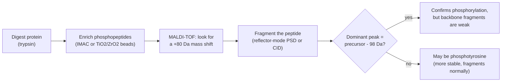

# Proteomics and PTMs

## Purpose

Earlier tabs in this guide use MALDI-TOF to match a whole, intact protein against a species database. This tab goes one level deeper: cutting proteins into peptides, weighing those peptides precisely, and using the exact numbers to answer a sharper question: has this protein been chemically altered after it was built? Spotting a post-translational modification (PTM), a small chemical change added to a protein after it is made, matters because PTMs switch genes on and off, turn cell signalling on or off, and mark proteins for destruction, in human cells, bacteria, and yeast alike.

## Key ideas

### Bottom-up proteomics: cutting proteins down to measurable pieces

Studying a protein's modifications usually starts with a "bottom-up" workflow, so called because it builds understanding up from small peptide pieces rather than reading the whole protein at once:

1. **Lyse the cells.** Human cells break open with a mild detergent buffer. Bacteria and yeast are tougher: bacteria often need an enzyme (lysozyme) to weaken the cell wall first, and yeast usually needs mechanical force (glass-bead beating), because its wall is thicker still.
2. **Reduce and alkylate.** A reducing agent breaks disulfide bonds (sulfur-sulfur links that hold a folded protein's shape together) so the protein unfolds completely, and an alkylating agent then caps the freed sites so they cannot re-form. This step is also why a fixed, known mass tag shows up on every cysteine later in a database search, a tag from this chemistry step, not from any real biology.
3. **Digest with trypsin.** Trypsin is an enzyme that reliably cuts a protein chain right after every lysine or arginine, turning one large, hard-to-weigh protein into a predictable set of small peptides that are each easy to measure precisely. Digestion typically runs overnight, well over 10 hours, at around 30 degrees Celsius (not 37, which causes evaporation problems over that long a run).
4. **Clean up (desalt) and spot with matrix**, the same matrix step used throughout this guide.
5. **Acquire the spectrum.** The result is a peptide mass fingerprint (PMF): a list of exact peptide masses.
6. **Search a database.** Software predicts what masses trypsin should have produced from every protein in a reference database, allowing for extra mass additions at specific amino acids (the PTMs), and finds the best match. A peak that lines up with a predicted mass plus a fixed extra amount is how a modification gets identified, not just a protein.

### Reading a mass shift: the core trick behind every example in this tab

A PTM is a small, specific chemical group tacked onto one amino acid. Because that group always has the same mass, it always shifts the peptide's peak by the same fixed number of daltons (Da), no matter which protein it sits on. Once you know the shift, spotting the modification is just arithmetic: subtract the expected unmodified mass from the mass you actually measured.

| PTM | Mass shift | Typical amino acid(s) | What it does in the cell |
| --- | --- | --- | --- |
| Phosphorylation | +80 Da | Serine, threonine, tyrosine | Switches signalling pathways on or off in seconds |
| Acetylation | +42 Da | Lysine, protein N-terminus | Controls gene expression and protein stability |
| Methylation | +14 Da per methyl | Lysine, arginine | Epigenetic regulation; can repeat (+28, +42 for di-, tri-methyl) |
| Ubiquitin remnant ("GG tag") | +114 Da | Lysine | Marks a protein for degradation |
| Oxidation | +16 Da | Methionine | Often a sign of oxidative stress, sometimes just a handling artifact |
| Glycosylation | Variable, often +203 Da per HexNAc unit or more | Asparagine, serine, threonine | Cell surface recognition, protein folding and stability |

A real phosphopeptide study using MALDI-TOF worked with peptides in the 1,100 to 2,400 Da range and confirmed that the clean +80 Da rule held across every phosphorylated serine, threonine, and tyrosine peptide tested, whether the sample was a synthetic standard or a real protein digest.

### Enriching and confirming phosphorylation

Phosphorylation is common but tricky to see directly, because phosphopeptides are usually rare in a digest and ionize poorly in positive-ion mode (the phosphate group's negative charge works against picking up the proton MALDI needs to detect it). The workflow below exists specifically to work around that:

Enrichment comes first, always: IMAC resin or titanium/zirconium dioxide beads selectively grab phosphopeptides out of a digest, because unmodified peptides would otherwise drown out the weak phosphopeptide signal. Then the search looks for the +80 Da mass shift, since a phosphate group (HPO3) adds almost exactly 80 Da (79.9663 Da, to be precise) per phosphorylated residue. Fragmenting the peptide to find exactly which residue carries the phosphate comes with a catch: phosphoserine and phosphothreonine are chemically fragile under standard fragmentation and tend to lose the whole phosphate group as neutral H3PO4, a 98 Da drop, before the backbone itself breaks apart. That loss is a great confirmation signal but a poor localization tool, since it dominates the spectrum and starves out the very fragments that would reveal the exact residue. Phosphotyrosine does not have this problem; it is more chemically stable and fragments normally.

## Worked example

This is the central worked example of this tab, reused from elsewhere in this guide: the peptide FQSEEQQQTEDELQDK, from beta casein (a real milk protein). Its unmodified, calculated mass is MH+ 1981.8 Da. The phosphorylated form, FQpSEEQQQTEDELQDK (the lowercase p marks the phosphate, sitting on the serine), comes in at MH+ 2061.8 Da.

1. **Find the difference.** 2061.8 minus 1981.8 equals 80.0 Da.
2. **Match it to the table above.** An 80 Da shift is the signature of phosphorylation; nothing else in the common PTM list matches that number.
3. **Check it makes biological sense.** Beta casein is a well-known, naturally phosphorylated milk protein, so a clean +80 Da peak here fits what is already known about it.
4. **Predict the confirmation experiment.** Treat a split of the same sample with a phosphatase enzyme (which strips phosphate groups) and re-run it on MALDI-TOF: the 2061.8 Da peak should disappear, and the 1981.8 Da peak should reappear.

**A live example close to home.** Aalto University's own Cellular Engineering research group, led by Assistant Professor Sesilja Aranko (Department of Bioproducts and Biosystems), works on exactly this kind of problem: installing post-translational modifications, including phosphorylation, hydroxylation, and glycosylation, onto recombinant structural proteins such as silk and collagen that are produced in bacteria, which cannot make these modifications on their own. The aim is to understand how a modification changes how the protein folds and assembles, then use that to engineer sustainable, functional biomaterials as alternatives to oil- and animal-based materials. This work is funded in part by a Novo Nordisk Foundation Emerging Investigator Grant (the Pro2Fun project, roughly 1.34 million euro over five years), and a Research Council of Finland project called CrossSilk looks at a related problem: improving the water resistance of silk and cellulose-based biomaterials. Verifying that a phosphate group (or any other PTM) really did attach, and only where intended, is exactly the kind of check a +80 Da mass shift on a MALDI-TOF spectrum is built for.

A closely related, published example (not from Aranko's own group, but in the same research area): a 2025 paper in *Trends in Biotechnology* reported producing phosphorylated and functional alpha-s1-casein, another real milk casein protein, in *E. coli*, by co-expressing two bacterial protein kinases alongside the casein gene. Mass spectrometry confirmed the phosphorylation, and the phosphorylated recombinant casein bound calcium and behaved much more like real bovine casein than the unphosphorylated version did.

**A second worked example, reading bacterial drug resistance as a mass shift.** The meropenem hydrolysis assay incubates live bacteria directly with the antibiotic meropenem and asks whether the drug's own mass changes. Intact meropenem shows up at m/z near 384. If a bacterial enzyme called a carbapenemase is present, it breaks open the drug's ring by adding a water molecule, a +18 Da mass shift, producing a new peak at m/z near 402. Testing two unknown bacterial isolates after a 3-hour incubation: isolate A shows a single strong peak at m/z 384 and nothing else, meaning the drug is unchanged and no carbapenemase is active; isolate B shows a peak at m/z 402 and almost no peak at 384, meaning the drug's ring was hydrolyzed and an active carbapenemase (commonly KPC, NDM, or VIM) is present. This test gives a result in as little as 3 to 4 hours, compared with the 1 to 2 days a traditional culture-based test takes, though a clinical lab would still confirm the specific resistance gene with a separate test afterward.

**A harder case: O-GlcNAcylation.** This modification adds a single sugar (GlcNAc) onto serine or threonine and behaves biologically like phosphorylation's twin, often competing for the exact same residues. Its mass shift (+203 Da) is the same mass as any single HexNAc sugar, so mass alone cannot tell it apart from other sugars, and like a phosphate group, it tends to pop off as a neutral loss before the backbone breaks, blocking exact site-mapping. Unlike N-glycosylation, it has no strict sequence rule and no simple release enzyme, so confirming it usually needs extra chemical tagging steps rather than a simple mass search.

**Scale in real research.** A yeast study tracked *Saccharomyces cerevisiae* across heat-shock and cold-stress conditions and quantified 9,357 phosphosites on 2,344 proteins, finding that 388 sites changed dynamically and about 36% of those responded to both heat and cold stress. A separate human-cell study built calibration curves from seven synthetic peptide pairs mixed in known ratios, and found that the matrix used (CHCA, DHB, or THAP) changes the measured ratio for the same sample, with reproducibility across repeats of only 5 to 10%, a reminder that MALDI-TOF is far more reliable for answering "is this modified" than "how much is modified".

## Figure

A figure (Phosphorylation shows up twice: as a +80 Da shift on the whole peptide, and as a 98 Da neutral loss once that peptide is fragmented, based on the "Proteomics and PTMs" tab of the MALDI-TOF Study Guide.) appears in the illustrated HTML version of this guide. Alt text: A diagram showing the unmodified peptide at MH+ 1981.8 Da shifting up by 80 Da to the phosphorylated peptide at MH+ 2061.8 Da, which then loses 98 Da on fragmentation to give the dominant fragment peak.

## Common misconceptions

- **"Every PTM can be found by searching for one fixed mass offset."** Only PTMs with a truly fixed chemical mass work this way, such as phosphorylation (+80 Da) or acetylation (+42 Da). A variable modification like glycosylation adds a different mass depending on which sugar chain is attached, so it needs a different kind of search entirely.
- **"A 98 Da loss during fragmentation tells you which exact residue is phosphorylated."** It confirms that phosphorylation is present, but because it dominates the spectrum, it actually makes it harder to see the backbone fragments that would pinpoint the exact residue.
- **"MALDI-TOF can tell you exactly how much of a protein is modified, just as easily as whether it is modified at all."** Quantifying a modification is far less reliable: the matrix used can change the measured ratio for the same sample, and repeat measurements can vary by 5 to 10%.
- **"O-GlcNAcylation can be found the same way as phosphorylation, since both add a small group to serine or threonine."** O-GlcNAcylation lacks phosphorylation's strict partner tools: there is no simple sequence rule and no simple release enzyme, so it usually needs extra chemical tagging steps that phosphorylation does not.

## Self-check questions

1. Why does the alkylation step in a bottom-up proteomics workflow leave a mass tag on every cysteine, even though it has nothing to do with the cell's own biology?
2. Using the FQSEEQQQTEDELQDK example, what mass shift confirms phosphorylation, and what further experiment would confirm it even more strongly?
3. Why is the 98 Da neutral loss described as a good confirmation signal but a poor localization tool?
4. In the meropenem assay, what mass shift indicates that a carbapenemase enzyme is active, and what does that mean clinically?
5. Why can a single fixed mass offset not be used to search for a glycan the way it can for a phosphate group?

### Answers

1. Because the alkylating agent used in sample preparation (commonly iodoacetamide) permanently caps every freed cysteine site with a small, known mass tag, regardless of the protein's actual biology, which is why it is entered as a fixed, global modification in the database search.
2. A +80 Da shift (2061.8 minus 1981.8 Da) confirms phosphorylation; treating a split sample with a phosphatase enzyme and seeing the 2061.8 Da peak disappear while the 1981.8 Da peak reappears would confirm it further.
3. Because the phosphate group falls off so readily as neutral H3PO4 during fragmentation that it dominates the spectrum, starving out the weaker backbone fragments that would otherwise reveal exactly which residue carries the phosphate.
4. A +18 Da mass shift (from m/z near 384 to near 402) indicates an active carbapenemase enzyme; clinically, this means the isolate is resistant to that class of antibiotic and should be flagged right away, even before the exact resistance gene is confirmed.
5. Because a glycan's mass depends on which and how many sugar units are attached, which varies a great deal from one copy of a glycopeptide to the next, unlike a phosphate group, which always adds the same 80 Da.

## What to take forward

Once a modification has a truly fixed mass, finding it is simple arithmetic: measure the peptide, subtract the expected unmodified mass, and match the difference to a known PTM shift such as +80 Da for phosphorylation; the next tab moves from proteins to smaller molecules, where MALDI-TOF measures metabolites instead.

## Glossary terms introduced

- Post-translational modification (PTM): a small chemical change added to a protein after it has been built.
- Bottom-up proteomics: identifying and studying proteins by first cutting them into peptides, then measuring those peptides.
- Trypsin: an enzyme that reliably cuts a protein chain right after every lysine or arginine, used to produce measurable peptides.
- Peptide mass fingerprint (PMF): the list of exact peptide masses measured from a digested protein, used to identify it by database search.
- Neutral loss: a small, uncharged chemical group (such as phosphoric acid) breaking off a peptide during fragmentation, seen as a drop in mass rather than a separate charged peak.
- Carbapenemase: a bacterial enzyme that breaks open a carbapenem antibiotic's ring, making the bacterium resistant to that drug.
- O-GlcNAcylation: a modification that attaches a single sugar unit to serine or threonine, often competing with phosphorylation for the same sites.
